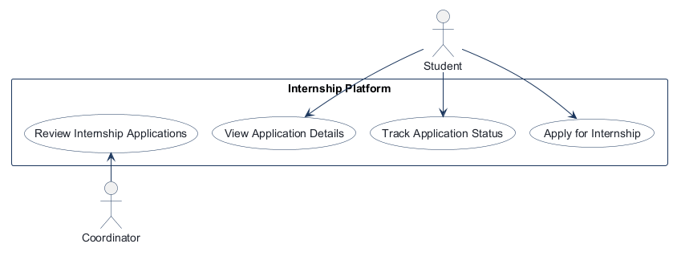
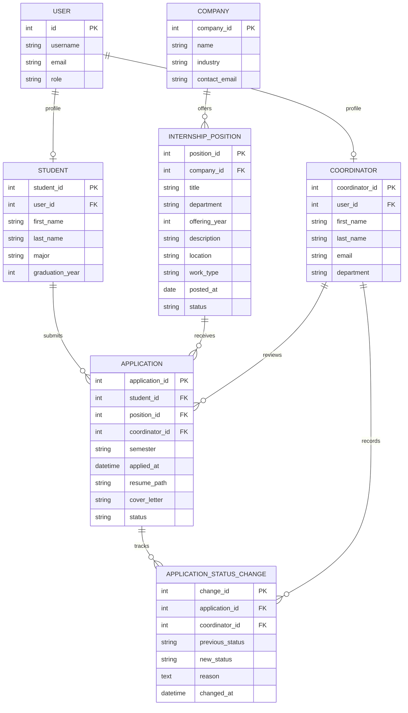
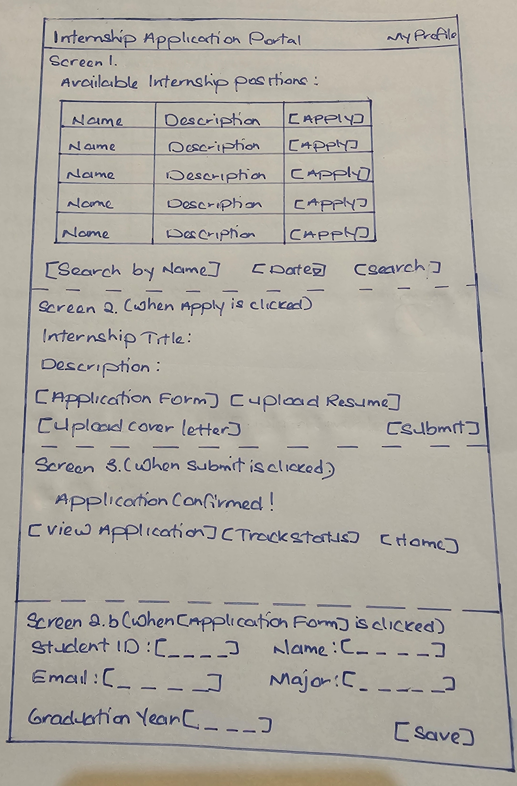
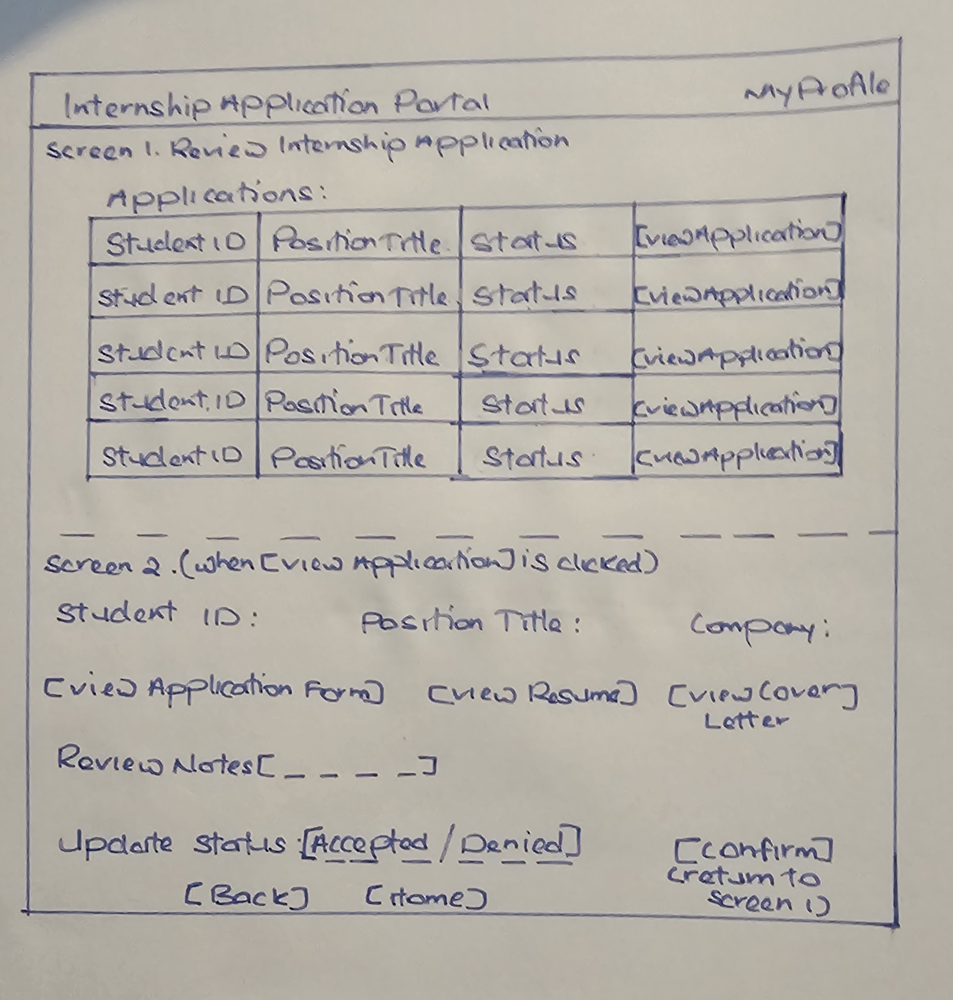
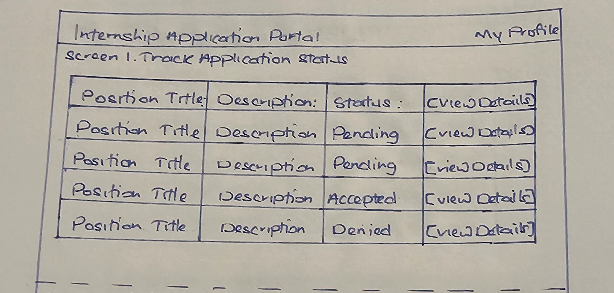
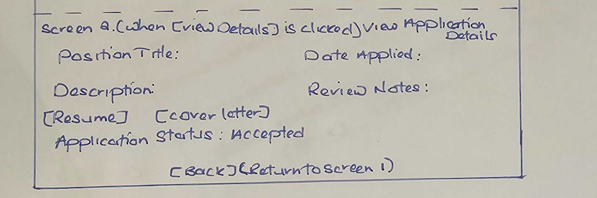

# COMP 3613 Assignment 1

Draft this file with the Guide. **Update it after every phase milestone** before you pause. The use-case diagram is a UML PNG at `docs/diagrams/use-case.png`, linked from this file as `diagrams/use-case.png` (path relative to `docs/report.md`). The model diagram is Mermaid. **Embed wireframe images** as `wireframes/<file>` (files live in `docs/wireframes/`).

Do not put your student ID in this file if you will commit it. The PDF cover adds your name and ID at export time.

## Assigned project

Internship Platform

## Three workflows

### 1.
Apply for Internship (Student)

### 2.
Review Internship Applications (Coordinator)

### 3.
Track Application Status (Student)

### 4.
View Application Details (Student)

## Use case diagram



Use-case draft assumptions: The student actor owns application submission, status tracking, and detail viewing; the coordinator owns reviewing incoming applications. The status workflow is distinct from detailed review, so “View Application Details” is a separate use case instead of being embedded within status tracking.

```json
{
  "system": "Internship Platform",
  "actors": [
    {"name": "Student", "side": "left"},
    {"name": "Coordinator", "side": "right"}
  ],
  "use_cases": [
    {
      "name": "Apply for Internship",
      "actors": ["Student"]
    },
    {
      "name": "Track Application Status",
      "actors": ["Student"]
    },
    {
      "name": "View Application Details",
      "actors": ["Student"]
    },
    {
      "name": "Review Internship Applications",
      "actors": ["Coordinator"]
    }
  ]
}
```
## Model diagram

First draft. Update this section in Phase 5 when polish revises the model, and note what changed.

Relationship notes:
- Each `Student` profile belongs to one signed-in `User`, and each user can have at most one student profile (`Student.user_id` is unique).
- Each `Coordinator` profile belongs to one signed-in `User`, and each user can have at most one coordinator profile (`Coordinator.user_id` is unique).
- A `Student` can submit many `Application` records, and each application belongs to one student.
- Student email is read from the linked `User` account rather than duplicated on the profile; `graduation_year` is stored as an integer.
- A `Company` offers many `InternshipPosition` records, and each position belongs to one company.
- An `InternshipPosition` can receive many applications, while each application targets one position.
- A `Coordinator` may review many applications, and each application is assigned to one coordinator immediately when submitted.
- Each `InternshipPosition` has one department value matching the reviewing `Coordinator.department`. Among matching coordinators, assign the new application to the one with the fewest pending applications; break ties by the fewest total assigned applications.
- Internship listings represent the Summer offering for one academic year. Store the offering year on `InternshipPosition`; derive the application's semester label as `Summer <year>` from the selected listing rather than asking the student to enter it.
- An internship is available to applicants only when at least one coordinator has the matching department; submission rechecks eligibility before assigning.
- Application records are archived at the end of each semester and retained for historical coordinator review; they are not deleted with the active queue.
- Keep application metadata and decisions, but remove the private résumé PDF one year after its semester ends.
- Each student may apply to many internships in a semester, but only once to each internship in that semester; a prior denial does not prevent applying to the same internship in a later semester. Use a unique constraint on `(student_id, position_id, semester)`.
- Coordinators may change the decision on the existing application from denied to accepted or from accepted to denied; this does not create another application record.
- Coordinators may change `pending` to `accepted` or `denied`, and may change `denied` to `accepted` or `accepted` to `denied`; a pending application with a rule violation can be denied.
- `revoked` is a distinct terminal status for an internship that is withdrawn after acceptance; the coordinator must provide a reason, displayed in a separate section from the status label and visible to the affected student. Only an accepted application can be revoked, and a revoked application cannot transition to another status.
- Each coordinator status change is recorded as a separate `ApplicationStatusChange` with the previous status, new status, acting coordinator, required reason, and timestamp. `Application.status` remains the current status; the history is retained when the application is archived. Coordinators can view the full history but cannot edit or delete its entries; each change appends a new event.
- When a student creates an `Application`, it links that student to the selected `InternshipPosition` and sets the initial application `status` to `pending`.
- A résumé is uploaded as a PDF and stored privately; `Application.resume_path` stores its opaque storage path, not a public URL.
- Each application is limited to one PDF upload; upload storage currently uses the local filesystem and will need persistent object storage before deployment.



## Wireframes

### Apply for Internship (Student)



### Review Internship Applications (Coordinator)



### Track Application Status (Student)



### View Application Details (Student)



Wireframe coverage notes:
- The set now covers all four named workflows: `Apply for Internship`, `Review Internship Applications`, `Track Application Status`, and `View Application Details`.
- The status and details flows are separated into distinct wireframes and can be read as two linked student journeys: list status first, then open a chosen application for details.
- The image filenames are now consistent with the workflow names and the report reflects the intended coverage.

## Theming

Brand: **Internship Application Portal**. The identity uses a text-only wordmark, a blue-and-white palette, bold modern Manrope headings, and DM Sans body text. The tone is professional and direct.

Applied the shared theme to the landing, login, and registration pages, including updated portal copy and form/button states. The authenticated shell uses the same wordmark and brand tokens. Removed the starter placeholder copy from the student and coordinator entry views; their routes remain as workflow entry points. The configuration utility (`/config`) is retained.

## Implementation notes

### Apply for Internship (Student)

Implemented an open-position search and application form with profile fields, cover letter, and private PDF résumé upload (5 MB maximum). Submission creates or updates the student's separate profile and creates a pending application; duplicate applications to the same position in the same Summer year are rejected. The résumé is stored under a generated key in the private local `var/resumes/` directory. The student verified a PDF submission and success message, and confirmed the independently scrolling position picker fits better. The student also verified that Summer year labels display and a repeated application shows the duplicate warning. Six idempotently seeded sample positions support the layout preview.

<!-- student-build:code-check
workflow: Apply for Internship
check: Student SQLModel profile fields and unique User foreign key
passed: yes
architecture_ok: yes
note: Student profile is separate from User; email remains on the linked account and graduation_year is an integer.
-->

<!-- student-build:code-check
workflow: Apply for Internship
check: Thin POST route calls ApplicationService.submit_application
passed: yes
architecture_ok: yes
note: Route binds form values, delegates application rules and persistence, and handles expected ValueError validation failures.
-->

### Review Internship Applications (Coordinator)

Coordinator profile model uses a separate one-to-one link to `User` and stores the coordinator's department for internship eligibility matching. New accounts use explicit `student` and `coordinator` role values; existing `regular_user` accounts remain accepted as students. Application and student-workspace routes now enforce student access server-side. Coordinator-only review gating and login routing will be added with the review route.

Review workflow implementation is complete. The `Coordinator` profile, `Application` assignment fields and per-semester uniqueness, `ApplicationStatusChange` audit model, `InternshipPosition.department` matching field, least-loaded coordinator selection, coordinator-ID persistence, staffed-position listing filter, idempotent demo department/coordinator seed data, coordinator queue/detail routes, read-only history display, status-change form, and coordinator login redirect are implemented. The seed creates an idempotent pending Computer Science review for `alex` (`alexpass`) assigned to `coord_compsci` (`coordpass`) without changing Bob's data. Review-detail polish added company and position context, an authorized résumé PDF link, and concise status-history timestamps; the seed repairs the demo row to use the current private résumé fixture key. Final polish changed the coordinator queue from internal numeric IDs to student names, position titles, and company names. The student verified the workflow against the wireframe.

<!-- student-build:code-check
workflow: Review Internship Applications
check: Coordinator SQLModel profile fields and unique User foreign key
passed: yes
architecture_ok: yes
note: Coordinator profile stores first_name, last_name, department, and a unique user_id foreign key.
-->

<!-- student-build:code-check
workflow: Review Internship Applications
check: Application SQLModel coordinator foreign key and per-semester uniqueness
passed: yes
architecture_ok: yes
note: One application per student/internship/semester; coordinator_id is required for immediate assignment.
-->

<!-- student-build:code-check
workflow: Review Internship Applications
check: ApplicationStatusChange SQLModel audit fields and foreign keys
passed: yes
architecture_ok: yes
note: Each event requires application, coordinator, previous/new status, reason, and timestamp; change_id is its sole primary key.
-->

<!-- student-build:code-check
workflow: Review Internship Applications
check: InternshipPosition department matching field
passed: yes
architecture_ok: yes
note: Required indexed department string matches Coordinator.department for assignment eligibility.
-->

<!-- student-build:code-check
workflow: Review Internship Applications
check: InternshipPosition summer offering year
passed: yes
architecture_ok: yes
note: Each internship listing has a required indexed offering_year used to derive its Summer semester label.
-->

<!-- student-build:code-check
workflow: Review Internship Applications
check: Repository count of a coordinator's pending applications
passed: yes
architecture_ok: yes
note: Count query filters Application rows by coordinator_id and pending status.
-->

<!-- student-build:code-check
workflow: Review Internship Applications
check: Repository count of all applications assigned to a coordinator
passed: yes
architecture_ok: yes
note: Count query filters Application rows by coordinator_id without a status restriction.
-->

<!-- student-build:code-check
workflow: Review Internship Applications
check: Repository selects a department-matched coordinator by workload
passed: yes
architecture_ok: yes
note: Eligible coordinators are ranked by pending count, total assigned count, and coordinator ID.
-->

<!-- student-build:code-check
workflow: Review Internship Applications
check: Service selects an eligible coordinator and rejects unmatched departments
passed: yes
architecture_ok: yes
note: ApplicationService calls the repository selection and stops before file storage when no matching coordinator exists.
-->

<!-- student-build:code-check
workflow: Review Internship Applications
check: Repository persists the selected coordinator foreign key
passed: yes
architecture_ok: yes
note: create_application requires coordinator_id and assigns it to the Application model.
-->

<!-- student-build:code-check
workflow: Review Internship Applications
check: Open-position listing filters to staffed departments
passed: yes
architecture_ok: yes
note: A correlated exists condition requires at least one Coordinator with a matching InternshipPosition.department.
-->

<!-- student-build:code-check
workflow: Review Internship Applications
check: Repository loads an application only for its assigned coordinator
passed: yes
architecture_ok: yes
note: Lookup filters on both application_id and coordinator_id and returns one record or None.
-->

<!-- student-build:code-check
workflow: Review Internship Applications
check: Repository lists assigned applications for coordinator review
passed: yes
architecture_ok: yes
note: Query filters by coordinator_id and sorts newest semester/application first.
-->

<!-- student-build:code-check
workflow: Apply for Internship
check: Duplicate application lookup includes the derived Summer semester
passed: yes
architecture_ok: yes
note: Existing application lookup filters by student, position, and semester derived from the position's offering_year.
-->

<!-- student-build:code-check
workflow: Review Internship Applications
check: Service verifies coordinator ownership before status changes
passed: yes
architecture_ok: yes
note: ApplicationService loads the application through the coordinator-scoped repository lookup and rejects missing/unassigned records.
-->

<!-- student-build:code-check
workflow: Review Internship Applications
check: Service requires a reason before status changes
passed: yes
architecture_ok: yes
note: Empty or whitespace-only reasons are rejected before status transition processing.
-->

<!-- student-build:code-check
workflow: Review Internship Applications
check: Repository atomically updates status and appends audit event
passed: yes
architecture_ok: yes
note: The previous status is captured before the update; the new status and ApplicationStatusChange are committed together with rollback on failure.
-->

<!-- student-build:code-check
workflow: Review Internship Applications
check: Service validates transitions and delegates status change
passed: yes
architecture_ok: yes
note: Service verifies assigned coordinator ownership, requires a reason, enforces the transition map, and delegates persistence to the repository.
-->

### Track Application Status (Student)

Implemented the student status table from the wireframe. Each row shows the internship position title, description, current application status, and a separate **View Details** link. The student query is scoped by the signed-in student's profile in the repository/service layers; the route only binds dependencies and renders the template. The details link uses a student-owned endpoint so one student cannot open another student's application by changing the URL. Alex verified that pending, accepted, and denied states are visible, and coordinator actions can be repeated without re-authentication when coordinator and student accounts use separate browser sessions. The application details page now includes the coordinator decision history and each recorded reason; this final addition was successfully verified.

<!-- student-build:code-check
workflow: Track Application Status
form: choice
layer: other
architecture_ok: yes
passed: yes
note: Student chose a separate View Details link for each status row, matching the distinct details workflow.
-->

<!-- student-build:code-check
workflow: Track Application Status
form: snippet
layer: model
architecture_ok: yes
passed: yes
note: Student confirmed the existing indexed Application.status field matches the ERD and supports the status list.
-->

<!-- student-build:code-check
workflow: Track Application Status
form: snippet
layer: router
architecture_ok: yes
passed: yes
note: Student completed the status route to construct ApplicationService, call get_student_applications, and render the view without persistence logic.
-->

<!-- student-build:code-check
workflow: Track Application Status
form: implementation
layer: repository
architecture_ok: yes
passed: yes
note: Repository joins Application to InternshipPosition and Company while filtering by the authenticated student's student_id.
-->

<!-- student-build:code-check
workflow: Review Internship Applications
form: polish
layer: repository
architecture_ok: yes
passed: yes
note: Coordinator queue now joins Student, InternshipPosition, and Company so the list identifies the applicant and internship instead of exposing internal application IDs.
-->

## Deployed app

Phase 6. Public Render URL (not localhost). Markers open this to mark the three workflows.

https://faststarter-3v9l.onrender.com

Deployment note: The application was deployed on Render from the committed
`render.yaml` blueprint. The blueprint created the free Oregon Postgres
database and Python web service, connected the service to the database through
Render's internal connection string, generated the production `SECRET_KEY` and
`CONFIG_PASSWORD`, and ran the configured production start command. The three
workflows were tested successfully on the live deployment.

## Logins

Every account a marker needs, including extra users added by the seed data:

- bob / bobpass — regular user
- alex / alexpass — demo student with a Computer Science application
- admin / adminpass — admin
- coord_business / coordpass — Business coordinator
- coord_compsci / coordpass — Computer Science coordinator
- coord_design / coordpass — Design coordinator
- coord_data / coordpass — Data Analytics coordinator
- coord_engineering / coordpass — Engineering coordinator
- coord_marketing / coordpass — Marketing coordinator

## YouTube URL
https://youtu.be/xTgr7fL7J6I
## Session transcripts

Filled when the Guide builds the report: the agent writes each Guide chat to `docs/transcripts/<slug>.md` (Copilot Agent, Cursor, or OpenCode). `python manage.py report` packages them. Do not paste chats here during the build.

## Competency (student-judge)

Filled when the report is built. Guide runs student-judge, writes `docs/judge.md`, and export appends the scorecard here.

## Skill integrity

Filled by `python manage.py report`. Do not edit the course skills.
