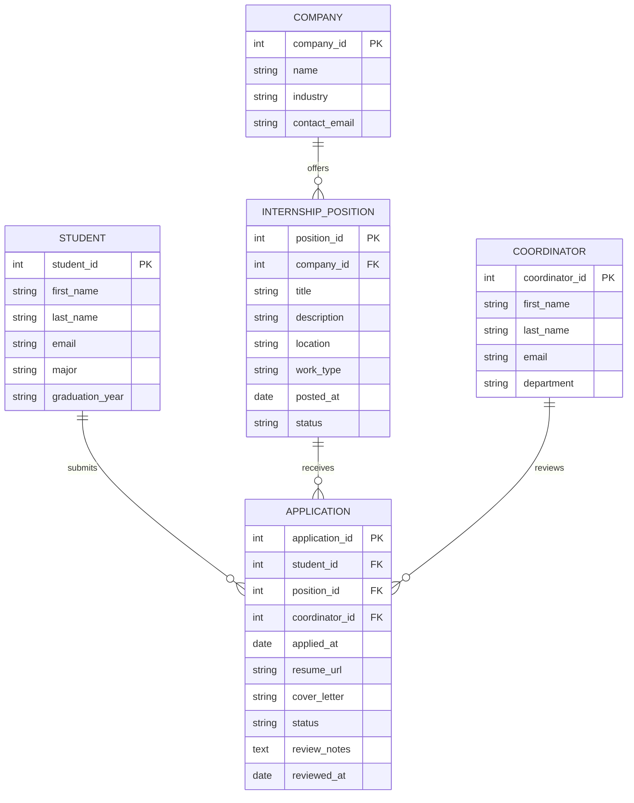

# COMP 3613 Assignment 1

Draft this file with the Guide. **Update it after every phase milestone** before you pause. The use-case diagram is a UML PNG at `docs/diagrams/use-case.png`, linked from this file as `diagrams/use-case.png` (path relative to `docs/report.md`). The model diagram is Mermaid. **Embed wireframe images** as `wireframes/<file>` (files live in `docs/wireframes/`).

Do not put your student ID in this file if you will commit it. The PDF cover adds your name and ID at export time.

## Assigned project

Internship Platform

## Three workflows

### 1.
Apply for Internship (Student)

### 2.
Review Internship Applications (Coordinator)

### 3.
Track Application Status (Student)

### 4.
View Application Details (Student)

## Use case diagram


Use-case draft assumptions: The student actor owns application submission, status tracking, and detail viewing; the coordinator owns reviewing incoming applications. The status workflow is distinct from detailed review, so “View Application Details” is a separate use case instead of being embedded within status tracking.

```json
{
  "system": "Internship Platform",
  "actors": [
    {"name": "Student", "side": "left"},
    {"name": "Coordinator", "side": "right"}
  ],
  "use_cases": [
    {
      "name": "Apply for Internship",
      "actors": ["Student"]
    },
    {
      "name": "Track Application Status",
      "actors": ["Student"]
    },
    {
      "name": "View Application Details",
      "actors": ["Student"]
    },
    {
      "name": "Review Internship Applications",
      "actors": ["Coordinator"]
    }
  ]
}
```
## Model diagram

First draft. Update this section in Phase 5 when polish revises the model, and note what changed.

Relationship notes:
- A `Student` can submit many `Application` records, and each application belongs to one student.
- A `Company` offers many `InternshipPosition` records, and each position belongs to one company.
- An `InternshipPosition` can receive many applications, while each application targets one position.
- A `Coordinator` may review many applications, but each application is assigned to one coordinator at a time.
- A student should not apply to the same position more than once, so a unique constraint on `(student_id, position_id)` is recommended.
- When a student creates an `Application`, it links that student to the selected `InternshipPosition` and sets the initial application `status` to `pending`.



## Wireframes

Embed each student-crafted wireframe here (Phase 4). Paths are relative to this file:

```markdown
### Explore / Search Publications


```

`python manage.py report` also embeds any PNG/JPG still missing from `docs/wireframes/`.

## Theming

Branding preferences and how they were applied (landing / login / register).

## Implementation notes

One named workflow at a time. Include verify notes and polish / model revisions (Phase 5). Do not treat the first build as final.

## Deployed app

Phase 6. Public Render URL (not localhost). Markers open this to mark the three workflows.

https://

## Logins

Every account a marker needs, including extra users you added. Starter accounts:

- bob / bobpass — regular user
- admin / adminpass — admin

## YouTube URL

## Session transcripts

Filled when the Guide builds the report: the agent writes each Guide chat to `docs/transcripts/<slug>.md` (Copilot Agent, Cursor, or OpenCode). `python manage.py report` packages them. Do not paste chats here during the build.

## Competency (student-judge)

Filled when the report is built. Guide runs student-judge, writes `docs/judge.md`, and export appends the scorecard here.

## Skill integrity

Filled by `python manage.py report`. Do not edit the course skills.
